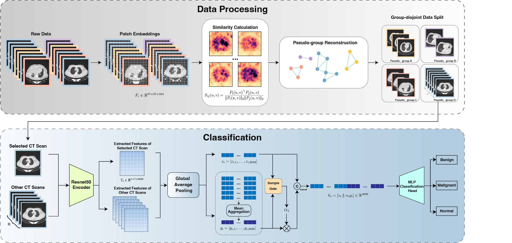

# Similarity-Aware Pseudo-Group Reconstruction for Lung CT Images

This repository provides the implementation of our similarity-aware pseudo-group reconstruction framework for 2D lung CT images.

Public 2D CT datasets may contain visually related slices originating from the same examination or lesion, while reliable patient- or case-level identifiers are not always available. Conventional image-level partitioning may therefore distribute correlated images across training and test sets.

To address this issue, we reconstruct pseudo-groups directly from image-derived visual similarity and use them for **group-disjoint evaluation** and **context-aware lung CT classification**.

---

## Overview

  

  <em>Overall framework of similarity-aware pseudo-group reconstruction, group-disjoint evaluation, and context-aware classification.</em>

The proposed framework consists of two main components:

1. **Similarity-aware pseudo-group reconstruction**
   - DINOv2 patch-feature extraction
   - same-position local feature similarity
   - strict seed construction
   - preliminary singleton expansion
   - adaptive candidate selection
   - conservative group refinement

2. **Pseudo-group-based downstream analysis**
   - group-disjoint train/validation/test partitioning
   - cross-split similarity analysis
   - context-aware classification using leave-one-out pseudo-group information

The reconstructed pseudo-groups represent potentially related CT images and should not be interpreted as verified patient identities when reference case information is unavailable.

---

## Method

### Local Feature Similarity

Patch-level representations are extracted from layer 8 of a pretrained DINOv2 ViT-S/14 encoder.

A local average-pooling operation is applied to the patch-feature grid, and spatially corresponding patch descriptors are compared using cosine similarity.

Each image pair is characterized using:

- median same-position patch similarity;
- spatial continuity of highly similar regions.

### Strict Seed Construction

High-confidence image relations are identified using strict similarity criteria.

Mutual top-ranked strict relations are used to construct the initial seed graph, and connected components define the initial pseudo-groups.

### Singleton Expansion

Singleton images are evaluated for possible attachment to existing seed groups using stringent pairwise similarity and group-support criteria.

### Adaptive Candidate Selection

Images that are not sufficiently connected by the strict criterion are further evaluated using locally calibrated similarity thresholds.

These adaptive relationships provide additional candidate evidence for subsequent group-level refinement.

### Conservative Group Refinement

Candidate group pairs are evaluated using cross-group similarity, spatial continuity, connectivity coverage, and group-size constraints.

Only candidates satisfying the required group-level conditions are merged.

Detailed definitions and reconstruction parameters are provided in [ALGORITHM.md](ALGORITHM.md).

---

## Datasets

### IQ-OTH/NCCD

Dataset source:  
[IQ-OTH/NCCD Lung Cancer Dataset](https://www.kaggle.com/datasets/hamdallak/the-iqothnccd-lung-cancer-dataset)

### LIDC-IDRI

Dataset source:  
[LIDC-IDRI - The Cancer Imaging Archive](https://www.cancerimagingarchive.net/collection/lidc-idri/)

---

## Results

### Pseudo-Group Reconstruction

On IQ-OTH/NCCD, the proposed method reconstructed **120 pseudo-groups** after refinement.

Compared with the strict-seed baseline, the reconstruction refinement reduced the number of singleton groups from **42 to 8**.

| Method | Groups | Singletons | Maximum group size |
|---|---:|---:|---:|
| Strict-seed baseline | 208 | 42 | 26 |
| **Full reconstruction** | **120** | **8** | **36** |

For external validation, the reconstruction framework was applied to the LIDC-IDRI cohort without using case identities or diagnostic labels during grouping.

The strict seed stage directly recovered **57 pseudo-groups corresponding to 57 reference cases**.

| Metric | Result |
|---|---:|
| Adjusted Rand Index (ARI) | **1.000** |
| Normalized Mutual Information (NMI) | **1.000** |
| Adjusted Mutual Information (AMI) | **1.000** |
| V-measure | **1.000** |
| Purity | **1.000** |
| Pairwise F1-score | **1.000** |

No fragmented reference case or contaminated pseudo-group was observed in the evaluated LIDC-IDRI cohort.

---

### Group-Disjoint Evaluation

Using reconstructed pseudo-groups as indivisible partitioning units substantially reduced cross-split visual similarity on IQ-OTH/NCCD.

| Similarity measure | Image-level split | Group-disjoint split |
|---|---:|---:|
| DINOv2 HSR @ 0.98 | 19.63% | **0.00%** |
| ResNet50 HSR @ 0.98 | 32.42% | **0.00%** |
| pHash HSR | 82.65% | **5.48%** |
| SSIM HSR @ 0.95 | 88.58% | **4.11%** |

The same overall pattern was independently reproduced on LIDC-IDRI using true case-disjoint partitioning.

---

### Context-Aware Classification

The reconstructed pseudo-groups were further used to construct leave-one-out contextual representations for CT-slice classification.

| Model | Accuracy | Macro-F1 |
|---|---:|---:|
| Image only | 0.7542 ± 0.0096 | 0.6412 ± 0.0479 |
| Pseudo-group context w/o gate | 0.8603 ± 0.0137 | 0.8157 ± 0.0198 |
| Random context + gate | 0.8063 ± 0.0175 | 0.7487 ± 0.0241 |
| **Pseudo-group context + gate (Ours)** | **0.9079 ± 0.0108** | **0.8726 ± 0.0152** |

For external evaluation on LIDC-IDRI, the IQ-OTH/NCCD-trained model was directly applied without retraining or fine-tuning.

| Model | Accuracy | Macro-F1 |
|---|---:|---:|
| ResNet50 | 0.8652 | 0.8763 |
| **Context-aware model (Ours)** | **0.8978** | **0.9070** |

Detailed experimental settings, additional similarity analyses, confidence intervals, and ablation results are reported in the manuscript.

---

## Code

The reconstruction implementation is organized into the following modules:

- `extraction.py` — DINOv2 patch-feature extraction.
- `similarity.py` — Same-position patch similarity and spatial-continuity computation.
- `strict_seeds.py` — High-confidence strict seed construction.
- `singleton_expansion.py` — Preliminary singleton attachment.
- `adaptive_edges.py` — Adaptive candidate relation selection.
- `group_refinement.py` — Conservative group-level refinement.

---

## Paper

**Similarity-Aware Pseudo-Group Reconstruction for Group-Disjoint Evaluation and Context-Aware Lung CT Classification**

Manuscript in preparation.

